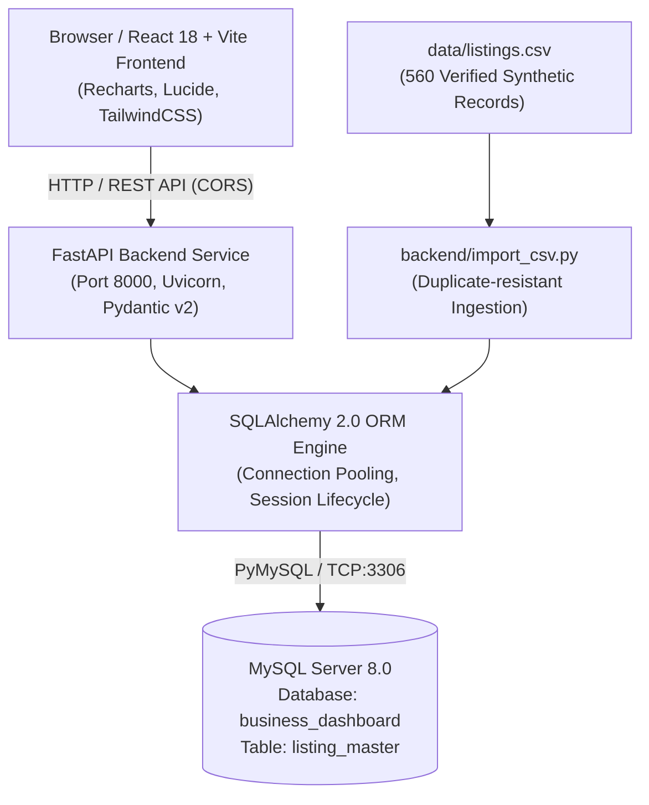

# Business Listings Dashboard - Architecture & Design

## System Architecture Overview

The Business Listings Dashboard is an enterprise-grade full-stack web application designed for exploring business listings and analyzing market density.

## Key Architectural Decisions

1. **Strict MySQL Aggregations (`GROUP BY`)**:
   In accordance with the assignment requirements, all analytics for cities, categories, and sources are computed via raw SQL `GROUP BY` expressions executed directly in MySQL. No aggregations are performed in memory.

2. **Deduplication Engine**:
   To prevent duplicate imports, the system applies composite uniqueness logic across `(business_name, city, address)`. The MySQL schema defines a unique key index, and the batch ingestion script buffers existing records to bypass duplicates efficiently without crashing the transaction.

3. **Responsive Admin Layout**:
   The frontend utilizes a modular component architecture with Tailwind CSS, supporting responsive views for tablets, desktops, and wide monitors.

4. **Synthetic Data Transparency**:
   All 560 records are generated with realistic Indian localities and industries, while retaining strict labels indicating sample origins (`Synthetic - Directory Sample`, etc.). No records are falsely claimed to be scraped.
